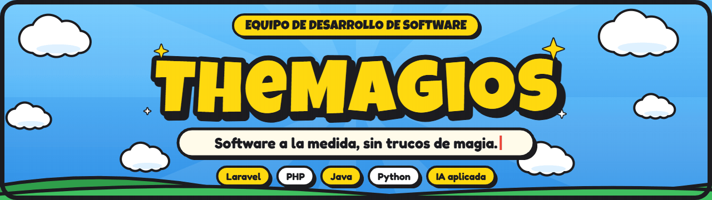

  

  
  

  
  

🔒 MProspector es un repositorio privado del equipo: aquí solo mostramos de qué va.

Hecho en equipo por TheMagios ✦ Ningún bug fue lastimado en la creación de esta página (bueno, casi ninguno).

